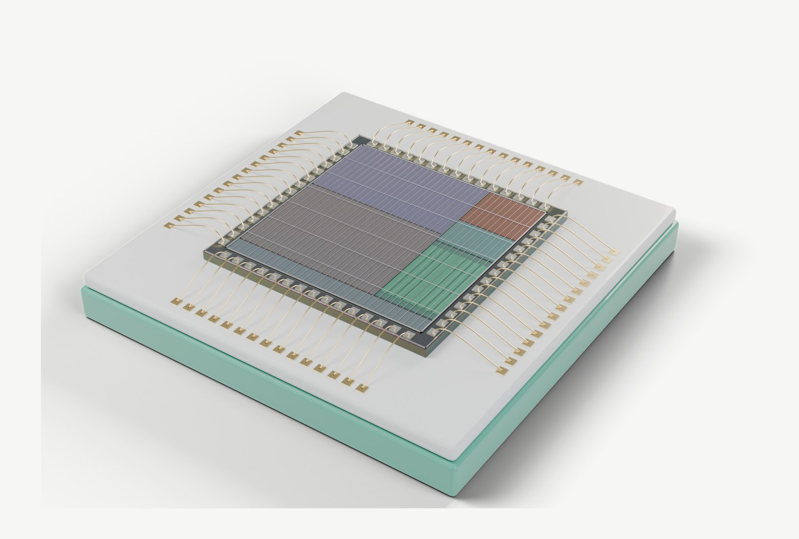
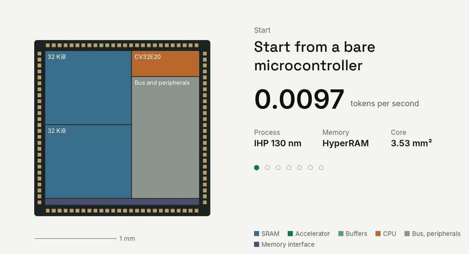
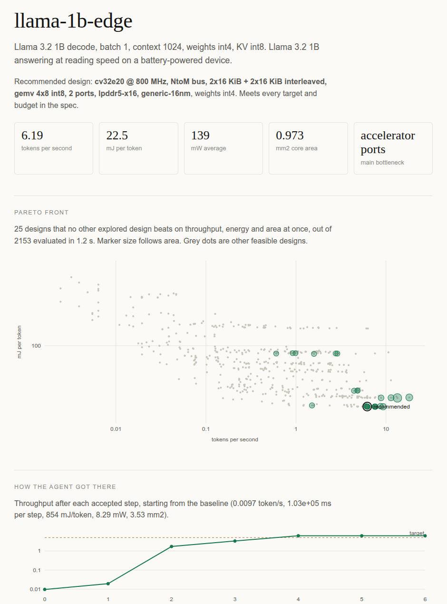
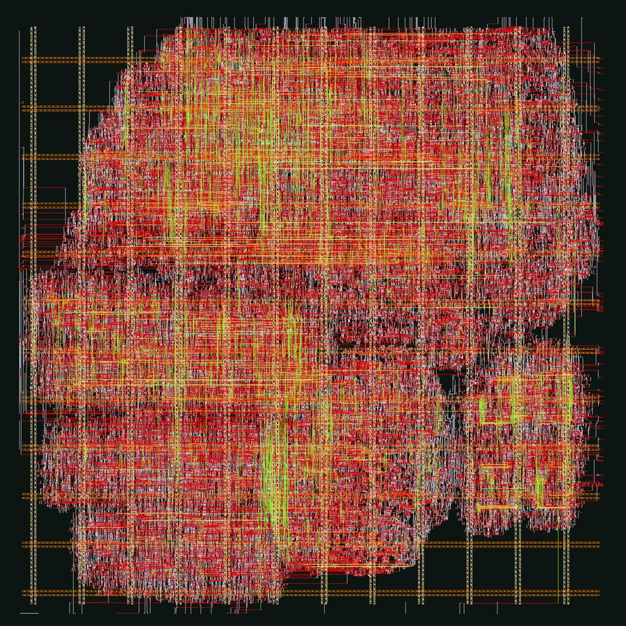

<p align="center">
  
</p>

<p align="center"><b>From a spec or from your RTL to GDS. Tell it the model and the speed you need, and ChipLeap<br>designs the chip, explains every choice and writes the RTL; or bring RTL of your own. Either way it checks it down to the layout.</b></p>

<p align="center">
  <a href="https://github.com/danieltyukov/chipleap/actions/workflows/ci.yml"></a>
  <a href="https://pypi.org/project/chipleap/"></a>
  <a href="LICENSE"></a>
  
</p>

<p align="center">
  <a href="https://danieltyukov.github.io/chipleap/">Website</a> ·
  <a href="#quick-start">Quick start</a> ·
  <a href="docs/">Docs</a> ·
  <a href="CHANGELOG.md">Changelog</a>
</p>

<p align="center">
  
  <br><sub>A chip ChipLeap designed for SmolLM2 135M on the open IHP 130 nm PDK, rendered to scale from its floorplan.</sub>
</p>

## What it does

You describe a workload (say, Llama 3.2 1B decoding), a target (5 tokens per second) and your limits (area, power, process nodes). ChipLeap works out the rest:

1. **Sizes the problem.** The bandwidth, compute and memory the target needs, and which memories and nodes can deliver them.
2. **Designs the architecture.** An agent finds the bottleneck, tries every single change, keeps the best one and writes down why. It chooses the on-chip memory, the external memory, the dataflow, the array size, the precision, the CPU, the clock and the node.
3. **Generates the hardware.** Accelerator RTL in SystemVerilog, an X-HEEP RISC-V SoC configuration or AXI4 IP for any host, a C driver, a testbench and a datasheet.
4. **Checks it.** Simulation against a golden model, synthesis, place and route, and the SoC generator's own checks, on open-source tools or the commercial ones you already have.

The generator is the path for AI workloads. For anything else, the checks run on RTL you wrote: see [Your own RTL](#your-own-rtl).

<p align="center">
  
  <br><sub>The agent's decisions for Llama 3.2 1B at 5 tokens per second. Every floorplan is drawn to the same scale.</sub>
</p>

## Quick start

```sh
pip install chipleap                # or: uv tool install chipleap
chipleap init llama.yaml            # an example spec to edit
chipleap explore llama.yaml -o out  # decisions, Pareto front and the hardware in out/
chipleap verify out                 # simulate, synthesize and check it
```

Open `out/report.html` to see each decision, the Pareto front and where the time goes.

<p align="center"></p>

## Your own RTL

Point ChipLeap at a directory of Verilog or SystemVerilog with cocotb tests:

```sh
chipleap project init path/to/rtl       # writes project.yaml: top, sources, clock, reset, tests
chipleap verify path/to/rtl             # lint, simulation, coverage, formal, CDC, synthesis, equivalence
chipleap verify path/to/rtl --steps all # and place and route to a GDS, then the tests on the routed netlist
```

Lint runs Verilator and slang, simulation runs the cocotb tests on Icarus or Verilator, coverage reports line, branch and toggle coverage, SymbiYosys proves the design's own assertions, a structural checker finds unsynchronized clock and reset domain crossings, synthesis maps to the IHP SG13G2 cells, equivalence shows the netlist implements the RTL, LibreLane routes it with the same slow-corner signoff as the accelerators, and the tests run again on the routed netlist with its SDF delays. With `--steps all` it also inserts scan chains with OpenROAD and generates stuck-at patterns with Fault, which it simulates through the chains; measures power from the activity of your own tests on the gate-level netlist and IR drop on the routed power grid; places UPF power domains with OpenROAD; and applies ECO changes to the routed design and signs it off again without placing it again. Failing tests come back by name, every problem with its file and line, and a failing property or netlist with its counterexample, which is also what an assistant gets through MCP to fix the RTL in a loop. [examples/uart](examples/uart) is a UART that routes to a clean GDS; [docs/projects.md](docs/projects.md) describes the project file.

## Ask your AI assistant

ChipLeap is also an MCP server, so Claude, Cursor, VS Code or Codex can drive it:

```sh
claude mcp add chipleap -s user -- chipleap mcp
```

Then ask things like *"Design the smallest chip on the IHP open PDK that runs SmolLM2 135M at two tokens per second"*, *"Why is this design memory bound, and what is the cheapest fix?"* or *"Make my RTL in ./uart lint clean and pass its tests"*. [docs/mcp.md](docs/mcp.md) covers the other clients.

## Works with what you have

- **Any workload:** twelve LLM presets (SmolLM2, Qwen, Gemma, Llama, Phi, TinyLlama), or your own network of convolutions and matrix multiplies.
- **Any RTL:** your own Verilog or SystemVerilog with cocotb tests, through the same checks down to the layout ([projects](docs/projects.md)).
- **After the layout:** DFT with scan chains and ATPG, gate-level power from your tests, IR drop, UPF power domains and ECOs on the routed design ([after place and route](docs/projects.md#after-place-and-route)).
- **Any host:** a complete X-HEEP RISC-V SoC, or the accelerator alone as AXI4 IP for an Arm, RISC-V or FPGA SoC ([platforms](docs/platforms.md)).
- **Open tools:** Verilator, Icarus, slang, cocotb, Yosys, LibreLane (OpenROAD, KLayout, Netgen) and Fault on the IHP SG13G2 open PDK.
- **Commercial tools:** Cadence Xcelium and Genus, Synopsys VCS and Design Compiler, Siemens Questa, on your machine or on a design server over ssh ([guide](docs/commercial-tools.md)).
- **Your own PDK:** `chipleap tech add` measures it from its liberty files and keeps the numbers on your machine.

Every tool is optional. `chipleap doctor` lists what it found, and `chipleap verify` skips what is missing and says why.

## Down to the layout



`chipleap verify out --steps all` adds place and route with LibreLane, the open flow Tiny Tapeout uses for its IHP shuttles. The picture is the GDS it wrote for the SmolLM2 chip's 1 x 8 GEMV engine: a 0.80 mm² core with clean DRC, LVS and antenna checks that meets its 90 MHz clock at the slow corner, with room to spare (about 101 MHz, and 148 MHz at the typical one).

The accelerator model is the same tile schedule the RTL runs, so it is checked against it:

- **Cycles:** equal to simulation without memory stalls, within a few percent with random stalls, on Verilator, Xcelium, VCS and Questa alike.
- **Area:** logic area within 3 % on average of synthesis on IHP SG13G2, across 12 configurations.
- **Clock:** the model allows what the routed accelerator meets at the slow corner: 100 MHz with one port, less with more ports or a wider GEMV engine.

The other nodes are scaled from published figures and say so. [docs/model.md](docs/model.md) lists every number and its source; [docs/verification.md](docs/verification.md) explains each check.

## Analog blocks from aispice

Mixed-signal chips need blocks from both sides. ChipLeap and its analog counterpart, [aispice](https://github.com/danieltyukov/aispice), hand hardened blocks to each other as macro packages: GDS, LEF, liberty, a Verilog model, a SPICE netlist, measured specs and DRC and LVS evidence, described by one `macro.toml`. Both tools check a package with the same rules before placing it:

```sh
chipleap macro check tiny_ota.macro --pdk ihp-sg13g2
```

[docs/macro-package.md](docs/macro-package.md) is the format, shared word for word with aispice.

## Learn more

| Guide | What it covers |
|---|---|
| [Spec format](docs/spec.md) | Workloads, targets, constraints and what the explorer may change |
| [Your own RTL](docs/projects.md) | The project file, and lint, simulation, coverage, formal, CDC, synthesis, equivalence, place and route, gate-level simulation, DFT, power, IR drop, UPF and ECO on your design |
| [The model](docs/model.md) | Timing, energy and area, with sources |
| [Verification](docs/verification.md) | Simulation, synthesis, place and route, the steps after it, X-HEEP checks |
| [Platforms](docs/platforms.md) | X-HEEP or AXI4 IP, and how to integrate each |
| [Commercial tools](docs/commercial-tools.md) | Cadence, Synopsys and Siemens tools, remote servers, your own PDK |
| [X-HEEP integration](docs/xheep.md) | How the accelerator plugs into the SoC |
| [Macro packages](docs/macro-package.md) | The block format ChipLeap and aispice share, and the rules both check |
| [Where it fits](docs/landscape.md) | Agentic EDA, workload-to-chip services and academic tools, compared |

## Contributing

Issues and pull requests are welcome; see [CONTRIBUTING.md](CONTRIBUTING.md). `pytest` runs the suite, and the hardware tests run when their tools are installed.

## License

MIT. Generated X-HEEP configurations carry X-HEEP's Apache-2.0 header. ChipLeap is an independent project, not affiliated with EPFL, IHP or any company named here.
