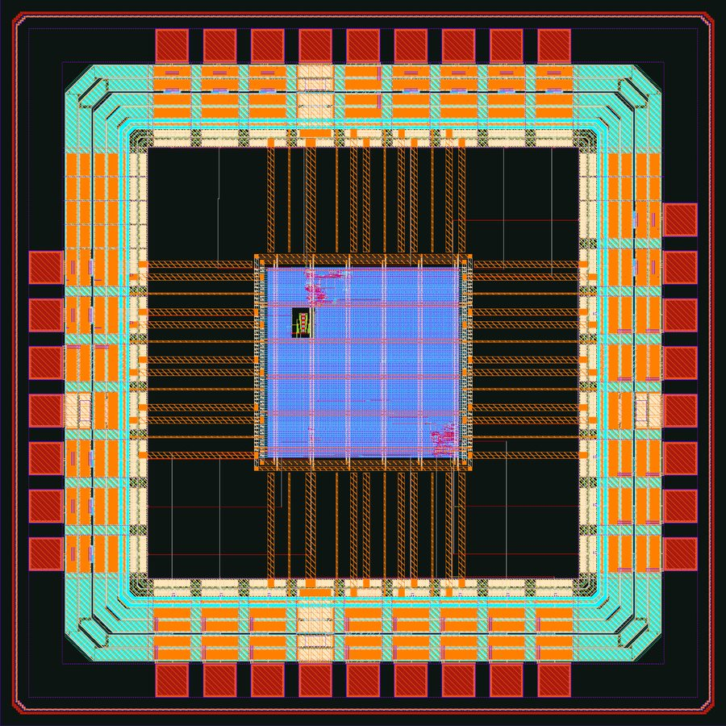

<p align="center">
  
</p>

<p align="center"><b>From a spec or from your RTL to GDS. Tell it the model and the speed you need, and ChipLeap<br>designs the chip, explains every choice and writes the RTL; or bring RTL of your own. Either way it checks it down to the layout.</b></p>

<p align="center">
  <a href="https://github.com/danieltyukov/chipleap/actions/workflows/ci.yml"></a>
  <a href="https://pypi.org/project/chipleap/"></a>
  <a href="LICENSE"></a>
  
</p>

<p align="center">
  <a href="https://danieltyukov.github.io/chipleap/">Website</a> ·
  <a href="#quick-start">Quick start</a> ·
  <a href="docs/">Docs</a> ·
  <a href="CHANGELOG.md">Changelog</a>
</p>

<p align="center">
  
  <br><sub>A chip ChipLeap designed for SmolLM2 135M on the open IHP 130 nm PDK, rendered to scale from its floorplan.</sub>
</p>

## What it does

You describe a workload (say, Llama 3.2 1B decoding), a target (5 tokens per second) and your limits (area, power, process nodes). ChipLeap works out the rest:

1. **Sizes the problem.** The bandwidth, compute and memory the target needs, and which memories and nodes can deliver them.
2. **Designs the architecture.** An agent finds the bottleneck, tries every single change, keeps the best one and writes down why. It chooses the on-chip memory, the external memory, the dataflow, the array size, the precision, the CPU, the clock and the node.
3. **Generates the hardware.** Accelerator RTL in SystemVerilog, an X-HEEP RISC-V SoC configuration or AXI4 IP for any host, a C driver, a testbench and a datasheet.
4. **Checks it.** Simulation against a golden model, synthesis, place and route, and the SoC generator's own checks, on open-source tools or the commercial ones you already have.

The generator is the path for AI workloads. For anything else, the checks run on RTL you wrote: see [Your own RTL](#your-own-rtl).

<p align="center">
  
  <br><sub>The agent's decisions for Llama 3.2 1B at 5 tokens per second. Every floorplan is drawn to the same scale.</sub>
</p>

## Quick start

```sh
pip install chipleap                # or: uv tool install chipleap
chipleap init llama.yaml            # an example spec to edit
chipleap explore llama.yaml -o out  # decisions, Pareto front and the hardware in out/
chipleap verify out                 # simulate, synthesize and check it
```

Open `out/report.html` to see each decision, the Pareto front and where the time goes.

<p align="center"></p>

## Your own RTL

Point ChipLeap at a directory of Verilog or SystemVerilog with cocotb tests:

```sh
chipleap project init path/to/rtl       # writes project.yaml: top, sources, clock, reset, tests
chipleap verify path/to/rtl             # lint, simulation, coverage, formal, CDC, synthesis, equivalence
chipleap verify path/to/rtl --steps all # and every step after it, down to the whole chip
```

Each step names what it found: a failing test with its file and line, a failing property or netlist with its counterexample, an unsafe crossing with the path between its registers. An assistant gets the same through MCP and can fix the RTL in a loop. [docs/projects.md](docs/projects.md) describes the project file and every step.

## The full digital flow

These are the steps ChipLeap runs on a project today, with what each reported for [examples/uart](examples/uart), a UART written by hand with cocotb tests and a Python reference model, at 100 MHz on IHP SG13G2. Every tool in the table is open source, and each step skips itself, with the reason, when its tool is missing; simulation, synthesis and place and route also run on Cadence, Synopsys and Siemens tools ([guide](docs/commercial-tools.md)).

| Step | Tools | The UART on this release |
|---|---|---|
| Project | `project.yaml`: top, sources, parameters, clocks, resets, tests, golden model | 3 SystemVerilog files, 5 cocotb tests, a Python model |
| Lint | Verilator `-Wall`, slang `-Wextra` | no warnings |
| Simulation | cocotb 2 on Icarus or Verilator, against the golden model | 5 of 5 tests pass |
| Coverage | Verilator line, branch and toggle coverage, with the points never reached | line 83.3 % (two `default:` arms no state reaches), branch 100 %, toggle 100 % |
| Formal | SymbiYosys on the design's own assertions | the transmitter's line in every state, proved for every cycle with `abc pdr` |
| Clock and reset crossings | ChipLeap's structural checker on the netlist Yosys elaborates | the receive line through a two-flop synchronizer, accepted; one warning, the reset released asynchronously |
| Synthesis | Yosys and ABC on IHP's standard cells | 221 cells, 51 flip-flops, 0.0041 mm², critical path 1.01 ns |
| Equivalence | Yosys (or EQY): RTL against synthesis, synthesis against the routed netlist | 74 of 75 points proved and the last equal for 40 cycles; all 969 routed points proved |
| Place and route | LibreLane (OpenROAD, KLayout), signed off at the slow corner | 352 cells on a 0.0105 mm² core, 100 MHz met at 125 C (about 264 MHz), DRC, LVS and antenna clean |
| Gate-level simulation | the cocotb tests on the routed netlist with SDF delays, Icarus 13 | 5 of 5 tests pass |
| Design for test | OpenROAD scan insertion, Fault with Quaigh for ATPG | 3 chains of 17 flip-flops, 99.2 % stuck-at coverage with 39 patterns, which pass through the scan and the routed netlists |
| Power | OpenROAD with the activity of the project's own tests | 0.345 mW at the typical corner (0.947 mW vectorless) |
| IR drop | OpenROAD PDNSim on the routed power grid | 0.52 mV at worst |
| Power intent | UPF read and placed by OpenROAD | the receiver in a domain of its own, 13 signals between the two |
| ECO | OpenROAD edits on the routed design, then LibreLane's signoff again | a gate resized and the UART signed off again in about a minute and a half |
| Macros | `macro/v1` packages, checked and rewritten before use | aispice's StrongARM comparator, 20.93 x 45 um, its transistors in LVS |
| Chip assembly | LibreLane with IHP's pad ring, then bond pads, seal ring and fill in KLayout | 33 pads on a 1.52 x 1.52 mm die |
| Timing at the ports | OpenSTA through IHP's IO cells at every corner | +0.971 ns of setup slack at the slow corner (+6.302 ns at the core's side of the pads) |
| Signoff | IHP's DRC deck on the whole die (density included), its LVS deck down to the macros' transistors, antenna | 0 DRC violations, LVS match, 0 antenna violations |

```sh
chipleap verify examples/uart               # lint to equivalence, in about half a minute
chipleap verify examples/uart --steps all   # and place and route, gate level, DFT, power, IR drop, UPF and the chip
```

<p align="center">
  
  <br><sub>The UART as a chip, drawn from its GDS before fill: 33 pads, IHP's IO ring, the core with aispice's comparator in its upper left, and the seal ring.</sub>
</p>

With a `chip` section the project becomes a whole chip ([docs/chips.md](docs/chips.md)): the core, hardened blocks from [macro packages](docs/macro-package.md) and a pad ring of IHP's IO cells, routed by LibreLane, with bond pads, seal ring and fill, timed at its own ports through the pads, checked with IHP's DRC and LVS decks, and a bond map for the package. The UART chip's comparator takes its inputs from two analog pads and drives the receive line. It builds and checks in about a quarter of an hour.

## Ask your AI assistant

ChipLeap is also an MCP server, so Claude, Cursor, VS Code or Codex can drive it:

```sh
claude mcp add chipleap -s user -- chipleap mcp
```

Then ask things like *"Design the smallest chip on the IHP open PDK that runs SmolLM2 135M at two tokens per second"*, *"Why is this design memory bound, and what is the cheapest fix?"* or *"Make my RTL in ./uart lint clean and pass its tests"*. [docs/mcp.md](docs/mcp.md) covers the other clients.

## Works with what you have

- **Any workload:** twelve LLM presets (SmolLM2, Qwen, Gemma, Llama, Phi, TinyLlama), or your own network of convolutions and matrix multiplies.
- **Any RTL:** your own Verilog or SystemVerilog with cocotb tests, through the same checks down to the layout ([projects](docs/projects.md)).
- **After the layout:** DFT with scan chains and ATPG, gate-level power from your tests, IR drop, UPF power domains and ECOs on the routed design ([after place and route](docs/projects.md#after-place-and-route)).
- **Any host:** a complete X-HEEP RISC-V SoC, or the accelerator alone as AXI4 IP for an Arm, RISC-V or FPGA SoC ([platforms](docs/platforms.md)).
- **Open tools:** Verilator, Icarus, slang, cocotb, Yosys, LibreLane (OpenROAD, KLayout, Netgen) and Fault on the IHP SG13G2 open PDK.
- **Commercial tools:** Cadence Xcelium and Genus, Synopsys VCS and Design Compiler, Siemens Questa, on your machine or on a design server over ssh ([guide](docs/commercial-tools.md)).
- **Your own PDK:** `chipleap tech add` measures it from its liberty files and keeps the numbers on your machine.

Every tool is optional. `chipleap doctor` lists what it found, and `chipleap verify` skips what is missing and says why.

## Down to the layout


`chipleap verify out --steps all` adds place and route with LibreLane, the open flow Tiny Tapeout uses for its IHP shuttles. The picture is the GDS it wrote for the SmolLM2 chip's 1 x 8 GEMV engine: a 0.80 mm² core with clean DRC, LVS and antenna checks that meets its 90 MHz clock at the slow corner, with room to spare (about 101 MHz, and 148 MHz at the typical one).

The accelerator model is the same tile schedule the RTL runs, so it is checked against it:

- **Cycles:** equal to simulation without memory stalls, within a few percent with random stalls, on Verilator, Xcelium, VCS and Questa alike.
- **Area:** logic area within 3 % on average of synthesis on IHP SG13G2, across 12 configurations, and buffers priced with the SRAM macros the layout places, equal to the routed SmolLM2 accelerator's.
- **Clock:** the model allows what the routed accelerator meets at the slow corner: 100 MHz with up to four ports, less with eight or more, and less for a GEMV engine with four or more lanes or more than eight columns.

The other nodes are scaled from published figures and say so. [docs/model.md](docs/model.md) lists every number and its source; [docs/verification.md](docs/verification.md) explains each check.

## Analog and mixed-signal: aispice

ChipLeap covers the digital side. Its analog counterpart, [aispice](https://github.com/danieltyukov/aispice), designs and sizes analog blocks on the same PDK: IC templates proven at every corner, layouts drawn by generators and checked with IHP's DRC and LVS decks, specs measured before and after extraction. It exports a block as a macro package, and assembles analog-on-top chips that place ChipLeap's digital blocks the same way.

The two tools hand hardened blocks to each other as macro packages: GDS, LEF, liberty, a Verilog model, a SPICE netlist, measured specs and DRC and LVS evidence, described by one `macro.toml`. Both check a package with the same rules before placing it:

```sh
chipleap macro check tiny_ota.macro --pdk ihp-sg13g2
```

[docs/macro-package.md](docs/macro-package.md) is the format, shared word for word with aispice.

## Learn more

| Guide | What it covers |
|---|---|
| [Spec format](docs/spec.md) | Workloads, targets, constraints and what the explorer may change |
| [Chips](docs/chips.md) | The pad ring, macros, timing at the ports, signoff and the bond map |
| [Your own RTL](docs/projects.md) | The project file, and lint, simulation, coverage, formal, CDC, synthesis, equivalence, place and route, gate-level simulation, DFT, power, IR drop, UPF and ECO on your design |
| [The model](docs/model.md) | Timing, energy and area, with sources |
| [Verification](docs/verification.md) | Simulation, synthesis, place and route, the steps after it, X-HEEP checks |
| [Platforms](docs/platforms.md) | X-HEEP or AXI4 IP, and how to integrate each |
| [Commercial tools](docs/commercial-tools.md) | Cadence, Synopsys and Siemens tools, remote servers, your own PDK |
| [X-HEEP integration](docs/xheep.md) | How the accelerator plugs into the SoC |
| [Macro packages](docs/macro-package.md) | The block format ChipLeap and aispice share, and the rules both check |
| [Where it fits](docs/landscape.md) | Agentic EDA, workload-to-chip services and academic tools, compared |

## Contributing

Issues and pull requests are welcome; see [CONTRIBUTING.md](CONTRIBUTING.md). `pytest` runs the suite, and the hardware tests run when their tools are installed.

## License

MIT. Generated X-HEEP configurations carry X-HEEP's Apache-2.0 header. ChipLeap is an independent project, not affiliated with EPFL, IHP or any company named here.
